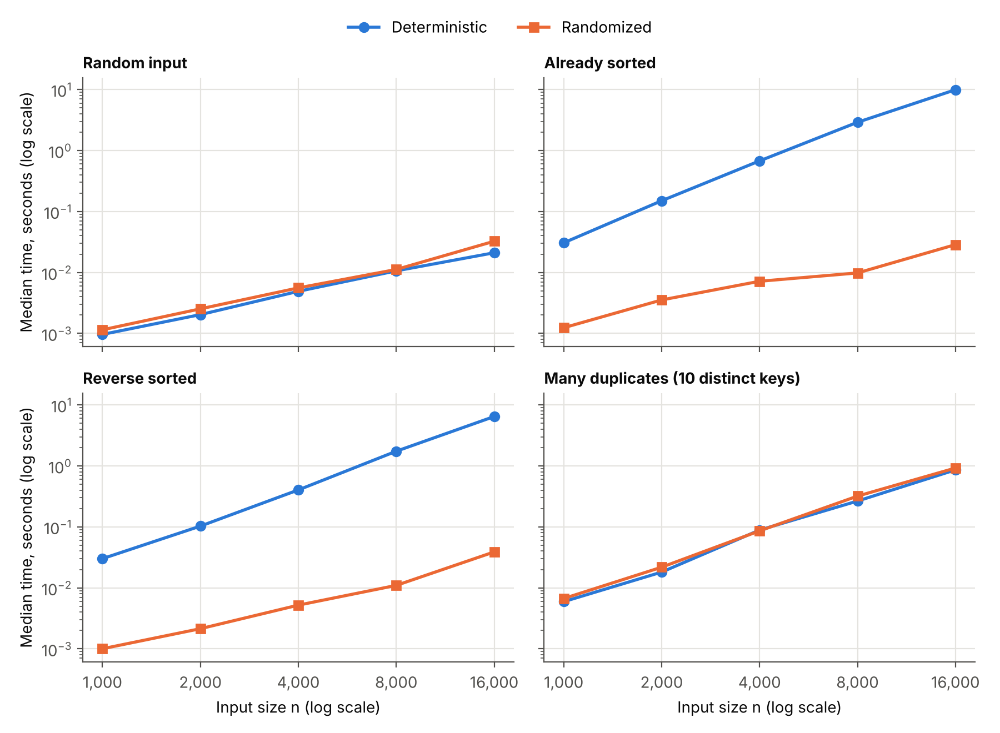
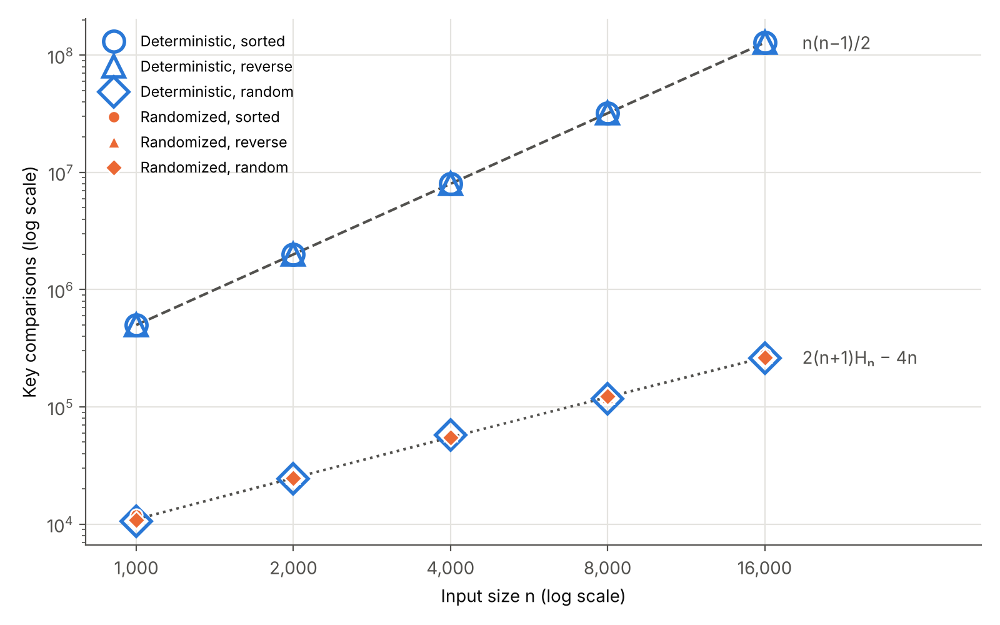

# Quicksort: Implementation, Analysis, and Randomization

MSCS-532-B01 Algorithms and Data Structures — Assignment 5
Soundarya Kavimani

This repository contains a deterministic Quicksort and a randomized Quicksort written in Python, unit tests, a benchmarking script, the measured results, and a report analyzing both versions.

## Repository contents

| File | What it is |
|---|---|
| `quicksort.py` | Both Quicksort versions (`deterministic_quicksort`, `randomized_quicksort`) with comments |
| `test_quicksort.py` | 10 unit tests that check both versions against Python's `sorted()` |
| `benchmark.py` | Runs the timing and comparison-count experiments, saves `results/results.csv` |
| `plot_results.py` | Draws the two charts from the CSV |
| `results/` | Raw results (`results.csv`, `benchmark_output.txt`) and charts (`.png`) |
| `Kavimani_Assignment5_Quicksort_Report.docx` | The full report (implementation, analysis, results, references) |

## How to run

You need Python 3.8 or newer. Only the charts need an extra package (`matplotlib`).

```bash
# 1. Try both sorts on a small example
python quicksort.py

# 2. Run the unit tests
python -m unittest -v

# 3. Run the experiments (about 3 minutes; use --quick for a 5-second version)
python benchmark.py
python benchmark.py --quick

# 4. Draw the charts (needs: pip install matplotlib)
python plot_results.py
```

Use in your own code:

```python
from quicksort import deterministic_quicksort, randomized_quicksort, Counter

data = [5, 2, 9, 1, 5, 6]
randomized_quicksort(data)          # sorts in place
print(data)                         # [1, 2, 5, 5, 6, 9]

c = Counter()
deterministic_quicksort(list(range(1000)), counter=c)
print(c.comparisons)                # 499500 = n(n-1)/2, the worst case
```

### Try each step from the terminal

Run these from inside the project folder (each is one line):

```bash
# One partition step (last element is the pivot)
python3 -c "from quicksort import partition; a=[38,27,43,3,9,82,10]; print('Before:', a); p=partition(a,0,len(a)-1); print('After: ', a); print('Pivot', a[p], 'is now at position', p)"

# Sort with the randomized version
python3 -c "from quicksort import randomized_quicksort; a=[38,27,43,3,9,82,10,3]; print('Input: ', a); print('Sorted:', randomized_quicksort(a))"

# One random-pivot step (run it several times to see different pivots)
python3 -c "import random; from quicksort import partition; a=[38,27,43,3,9,82,10]; r=random.randint(0,len(a)-1); print('List:', a); print('Random index chosen:', r, '-> pivot', a[r]); a[r],a[-1]=a[-1],a[r]; p=partition(a,0,len(a)-1); print('After partition:', a); print('Pivot', a[p], 'is now at position', p)"

# Deterministic vs randomized on an already sorted list of 1,000 numbers
python3 -c "from quicksort import *; a=list(range(1,1001)); c1=Counter(); deterministic_quicksort(list(a),c1); c2=Counter(); randomized_quicksort(list(a),c2); print('Sorted list of 1000 numbers'); print('Deterministic comparisons:', c1.comparisons); print('Randomized comparisons:   ', c2.comparisons)"
```

## Implementation summary

- **Same partition for both versions** (Lomuto scheme). The only difference is the pivot rule: last element (deterministic) vs. a uniformly random element (randomized). This isolates the effect of randomization.
- **In place.** No copies of the list are made.
- **Recurse on the smaller side, loop on the larger side.** This keeps the call stack at O(log n) even in the worst case, so sorted input of 16,000 elements does not hit Python's recursion limit.
- **Comparison counter.** An optional counter records every key comparison, a measure that does not depend on the computer.

## Complexity

| | Best | Average | Worst | Extra space |
|---|---|---|---|---|
| Deterministic (last pivot) | Θ(n log n) | Θ(n log n) | Θ(n²) on sorted / reverse-sorted input | O(log n) |
| Randomized pivot | Θ(n log n) | Θ(n log n) expected for **every** input | Θ(n²), but extremely unlikely | O(log n) |

Expected comparisons with random pivots: 2(n+1)Hₙ − 4n ≈ 1.39 n log₂ n.

## Summary of findings (n = 16,000)

| Input | Deterministic | Randomized |
|---|---|---|
| Random | 260,945 comparisons, 0.021 s | 263,124 comparisons, 0.033 s |
| Already sorted | 127,992,000 comparisons, 9.9 s | 281,525 comparisons, 0.029 s |
| Reverse sorted | 127,992,000 comparisons, 6.4 s | 268,990 comparisons, 0.039 s |
| 10 distinct keys | 12,852,965 comparisons, 0.86 s | 12,868,334 comparisons, 0.92 s |

- On **random** input both versions match the theoretical expectation (264,263 comparisons); randomization adds a small time cost.
- On **sorted and reverse-sorted** input the deterministic version makes exactly n(n−1)/2 comparisons and runs 165–350× slower; the randomized version stays at n log n.
- With **many duplicate keys** both versions slow down to about n²/20 comparisons. Randomization does not fix this; three-way partitioning would.

Times were measured on a Linux machine (Intel Xeon 2.1 GHz, Python 3.13) and will differ on other computers. Comparison counts will be the same everywhere.




